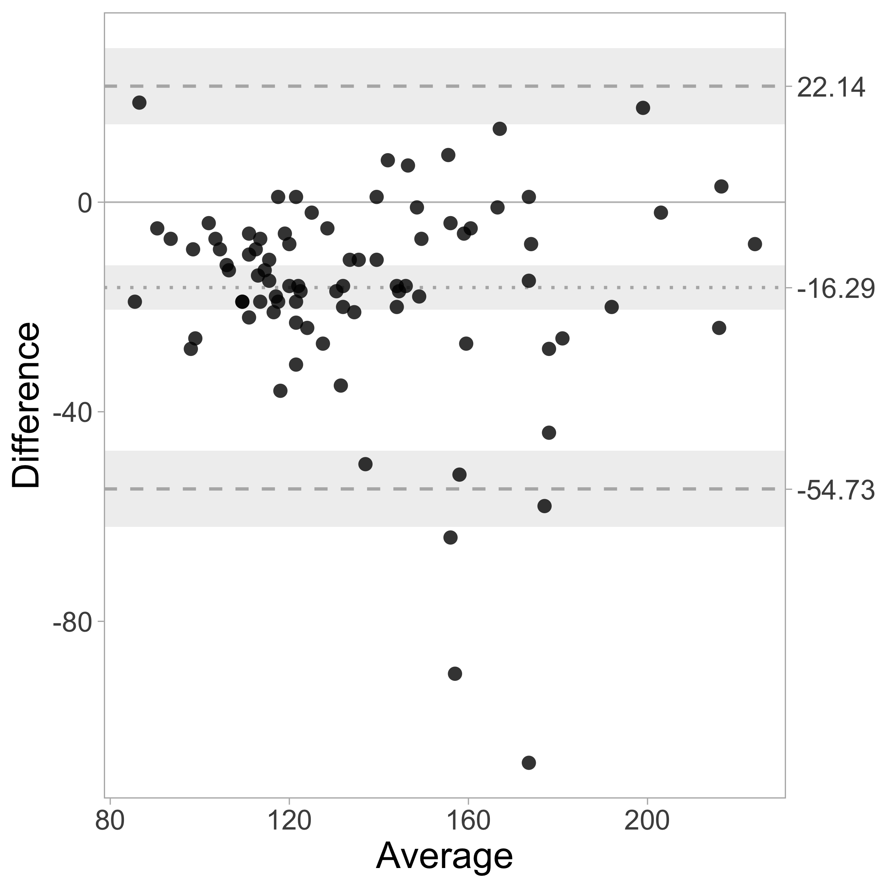

# BA plotteR
A Shiny App for making Bland-Altman plots


### Running the App

The web-tool runs from a shiny server, and can be accessed at:

o [https://huygens.science.uva.nl/BA-plotteR/](https://huygens.science.uva.nl/BA-plotteR/)

o [https://uva-nl.shinyapps.io/BA-plotteR/](https://uva-nl.shinyapps.io/BA-plotteR/)

Alternatively, the app can run from R/Rstudio and this is perhaps the best option for loading large files. See instructions below

#### Preparations
Note that the app depends on several R packages that need to be installed (shiny, ggplot2, dplyr, magrittr, ggrepel, DT, shinycssloaders, RCurl). 

Run this command in R/Rstudio to download and install all the packages (only needs to be done once):
```
install.packages("shiny", "ggplot2", "dplyr", "magrittr", "ggrepel", "DT", "shinycssloaders", "RCurl")
```
o The first option is running it directly from Github. In the command line (in R or Rstudio) type:
```
shiny::runGitHub('BA-plotteR', 'JoachimGoedhart')
```
o The second option is download the app and to use it offline:

-download the `app.R` and csv files with example data.

-Run RStudio and load `app.R`

-Select 'Run All' (shortcut is command-option-R on a Mac) or click on "Run App" (upper right button on the window)

This should launch a web browser with the Shiny app.


### Credits

BA-plotteR is created and maintained by Joachim Goedhart ([@joachimgoedhart](https://twitter.com/joachimgoedhart))

### Example output

Standard output generated with the example data:


